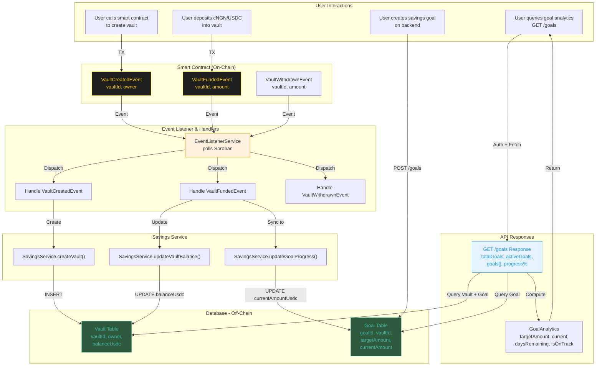
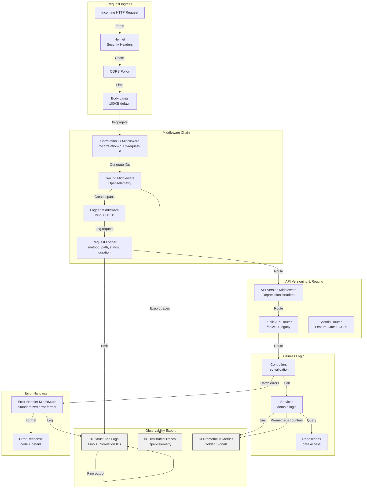
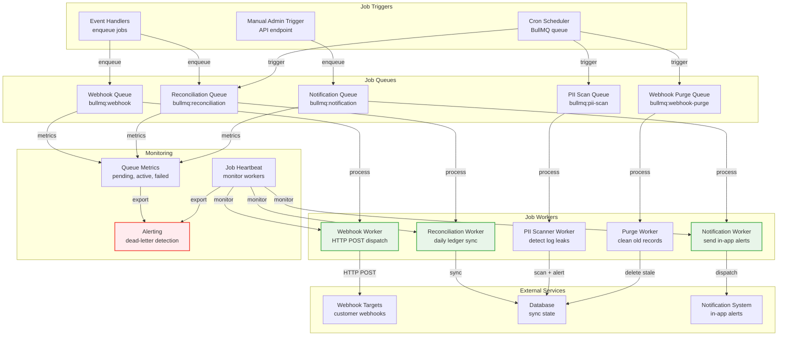
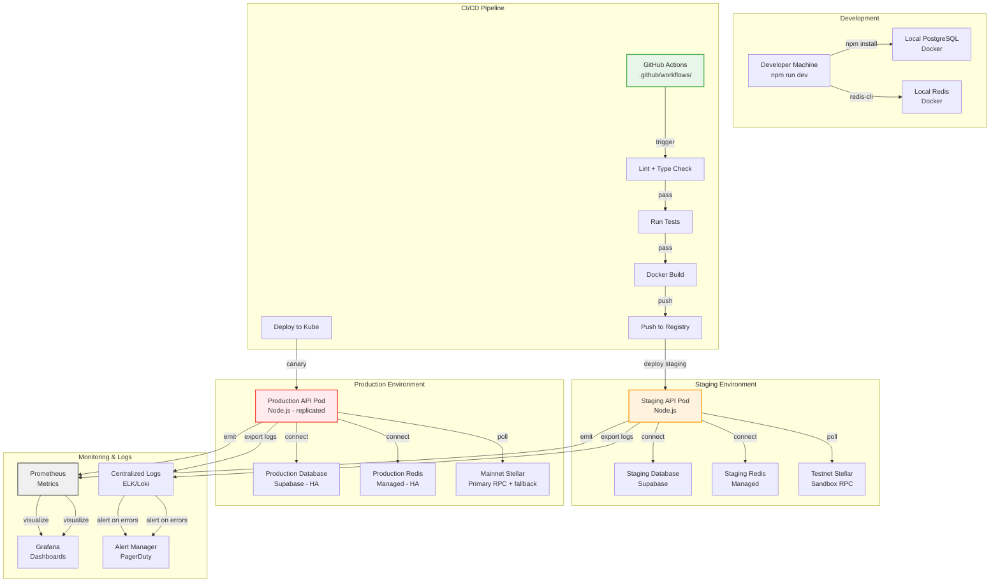

# System-Wide Architecture Diagram

This document provides a comprehensive visual representation of the Amana backend architecture, showing all major subsystems, their interactions, data flows, and integration points.

---

## 1. High-Level System Architecture

```mermaid
graph TB
    subgraph "Clients"
        Web["🌐 Web Frontend<br/>Next.js"]
        Mobile["📱 Mobile App<br/>React Native"]
        Admin["🔧 Admin Dashboard"]
    end

    subgraph "Client Authentication & Wallet"
        Freighter["🔐 Freighter Wallet"]
        Albedo["🔐 Albedo Wallet"]
        Auth["Authentication Service<br/>JWT + Signature Challenge"]
    end

    subgraph "Blockchain"
        Stellar["⛓️ Stellar Network"]
        Soroban["Soroban Contract<br/>amana_escrow"]
    end

    subgraph "Backend API Layer - Express.js"
        Router["Public API Router<br/>/api/v1 & legacy /"]
        PublicAPI["Public Routes"]
        AdminAPI["Admin Routes"]
    end

    subgraph "Backend Core Services"
        Trade["Trade Service<br/>CRUD + Validation"]
        Dispute["Dispute Service<br/>Status + Mediation"]
        Savings["Savings Service<br/>Vaults & Goals"]
        Evidence["Evidence Service<br/>IPFS + Uploads"]
        Auth2["Auth Service<br/>Challenge + JWT"]
    end

    subgraph "Integration Services"
        Stellar2["Stellar Service<br/>TX Build + Sign"]
        Contract["Contract Service<br/>Soroban ABI"]
        IPFS["IPFS Service<br/>Pinata Gateway"]
        Webhook["Webhook Service<br/>HTTP Dispatch"]
    end

    subgraph "Event Processing Pipeline"
        EventListener["Event Listener Service<br/>Poll Soroban RPC"]
        EventHandlers["Event Handlers<br/>Dispatch by Type"]
        Dedup["Deduplication<br/>ProcessedEvent"]
        Outbox["Retry Outbox<br/>ChainEventOutbox"]
    end

    subgraph "Data Layer"
        DB["Supabase PostgreSQL<br/>Prisma ORM"]
        Redis["Redis Cache<br/>Idempotency + Locks"]
    end

    subgraph "Observability"
        Logging["Structured Logging<br/>Pino + Correlation IDs"]
        Tracing["OpenTelemetry Tracing<br/>Jaeger/Zipkin"]
        Metrics["Prometheus Metrics<br/>Golden Signals"]
    end

    Web -->|Login| Auth
    Mobile -->|Login| Auth
    Admin -->|Login + Verify| Auth
    Freighter -->|Sign Challenge| Auth
    Albedo -->|Sign Challenge| Auth

    Auth -->|Generate JWT| Auth2

    Web -->|REST Calls| Router
    Mobile -->|REST Calls| Router
    Admin -->|REST + CSRF| Router

    Router -->|Route| PublicAPI
    Router -->|Route (Auth Required)| AdminAPI

    PublicAPI -->|Trade Ops| Trade
    PublicAPI -->|Dispute Ops| Dispute
    PublicAPI -->|Goal Analytics| Savings
    PublicAPI -->|Evidence Upload| Evidence

    AdminAPI -->|Manage Streams| AdminAPI
    AdminAPI -->|Batch Operations| AdminAPI
    AdminAPI -->|Audit Logs| AdminAPI

    Trade -->|Create/Fund TX| Stellar2
    Dispute -->|Resolve TX| Stellar2
    Savings -->|Vault TX| Stellar2

    Stellar2 -->|Sign TX| Contract
    Contract -->|Send TX| Stellar

    Stellar -->|Emit Events| EventListener
    EventListener -->|Parse Events| Dedup
    Dedup -->|Deduplicate| Outbox
    Outbox -->|Dispatch| EventHandlers

    EventHandlers -->|Handle Trade Events| Trade
    EventHandlers -->|Handle Dispute Events| Dispute
    EventHandlers -->|Handle Vault Events| Savings

    Trade -->|Read/Write| DB
    Dispute -->|Read/Write| DB
    Savings -->|Read/Write| DB
    Evidence -->|Read/Write| DB

    Evidence -->|Upload/Stream| IPFS

    Trade -->|Cache| Redis
    Evidence -->|Idempotency| Redis

    Trade -->|Dispatch| Webhook
    Dispute -->|Dispatch| Webhook
    Savings -->|Dispatch| Webhook

    Trade -->|Log| Logging
    Dispute -->|Log| Logging
    Savings -->|Log| Logging
    Stellar2 -->|Log| Logging
    EventListener -->|Log| Logging

    Trade -->|Trace| Tracing
    Dispute -->|Trace| Tracing
    Savings -->|Trace| Tracing
    EventListener -->|Trace| Tracing

    Trade -->|Emit| Metrics
    Dispute -->|Emit| Metrics
    Savings -->|Emit| Metrics
    EventListener -->|Emit| Metrics

    style Stellar fill:#1f1f1f,stroke:#ffd700,stroke-width:3px,color:#ffd700
    style Soroban fill:#1f1f1f,stroke:#ffd700,stroke-width:2px,color:#ffd700
    style DB fill:#2d5a3d,stroke:#4db8a8,stroke-width:2px,color:#4db8a8
    style Redis fill:#c41e3a,stroke:#fff,stroke-width:2px,color:#fff
    style IPFS fill:#0a7088,stroke:#00a3e0,stroke-width:2px,color:#00a3e0
```

---

## 2. Request Flow: Trade Creation to Settlement

This diagram shows how a single trade request flows through the entire system from creation through event processing.

```mermaid
graph LR
    Client["Client<br/>POST /trades"]
    Router["Public Router"]
    TradeCtrl["Trade Controller<br/>validateRequest + auth"]
    TradeSvc["Trade Service<br/>Business Logic"]
    ContractSvc["Contract Service<br/>Build Soroban TX"]
    StellarSvc["Stellar Service<br/>Sign + Submit"]
    DB1["Database<br/>INSERT Trade"]
    EventLoop["Event Listener<br/>Poll for Events"]
    Handler["Event Handler<br/>handle(TradeCreated)"]
    DB2["Database<br/>UPDATE Trade.status"]
    WebhookSvc["Webhook Service<br/>HTTP POST"]
    Client2["Webhook Target<br/>Receive Event"]

    Client -->|"1. POST /trades"| Router
    Router -->|"2. Route"| TradeCtrl
    TradeCtrl -->|"3. Validate + Auth"| TradeSvc
    TradeSvc -->|"4. Validate Business Rules"| TradeSvc
    TradeSvc -->|"5. Build Soroban TX"| ContractSvc
    ContractSvc -->|"6. Create Transaction"| StellarSvc
    StellarSvc -->|"7. Submit to Stellar"| Stellar["Stellar Network"]
    TradeSvc -->|"8. Create Record (PENDING_SIGNATURE)"| DB1
    Client -->|"9. Return 201 Created<br/>with tradeId"| Client

    Stellar -->|"10. Emit TradeCreated Event"| EventLoop
    EventLoop -->|"11. Deduplicate"| Handler
    Handler -->|"12. update status → CREATED"| DB2
    Handler -->|"13. Dispatch trade.created webhook"| WebhookSvc
    WebhookSvc -->|"14. HTTP POST"| Client2

    style Client fill:#e1f5e1,stroke:#4caf50
    style Stellar fill:#1f1f1f,stroke:#ffd700,color:#ffd700
    style Handler fill:#fff3e0,stroke:#ff9800
    style DB1 fill:#e3f2fd,stroke:#2196f3
    style DB2 fill:#e3f2fd,stroke:#2196f3
```



---

## 3. Event Processing Pipeline

This diagram details the complete event ingestion, deduplication, retry, and handling flow.

```mermaid
graph TB
    subgraph "Polling"
        Stellar["Stellar Network<br/>Soroban RPC"]
        Poll["EventListenerService.poll()"]
        GetEvents["sorobanRpc.getEvents()"]
    end

    subgraph "Deduplication"
        InMem["In-Memory Set<br/>last N ledgers"]
        Check["Check (ledgerSeq,<br/>contractId, eventId)"]
        ProcessedEv["ProcessedEvent Table<br/>Durable Dedup"]
    end

    subgraph "Retry Outbox"
        Outbox["ChainEventOutbox<br/>INSERT or PENDING"]
        CheckStatus["SELECT status"]
        IsProcessed{Processed?}
        IsPending{Pending?}
        Update["UPDATE nextAttemptAt<br/>with exponential backoff"]
        DeadLetter["Move to DEAD_LETTER<br/>if maxAttempts exceeded"]
    end

    subgraph "Dispatch"
        Handler["EventHandlers.dispatch()"]
        Switch["Switch on eventType"]
        TypeMap["TradeCreated |<br/>TradeFunded |<br/>DeliveryConfirmed |<br/>FundsReleased |<br/>DisputeInitiated |<br/>VaultFunded |<br/>GoalCreated | ..."]
    end

    subgraph "Handlers"
        TradeHandler["Trade Event Handler<br/>update Trade.status"]
        DisputeHandler["Dispute Event Handler<br/>update Dispute.status"]
        SavingsHandler["Savings Event Handler<br/>updateGoalProgress()"]
    end

    subgraph "Persistence"
        DB["Prisma Transaction<br/>Atomic Write"]
        WebhookQ["Webhook Queue<br/>Enqueue for dispatch"]
    end

    Stellar -->|Poll every N seconds| Poll
    Poll -->|Call| GetEvents
    GetEvents -->|Return Events| InMem

    InMem -->|Check each event| Check
    Check -->|Already seen?| ProcessedEv
    ProcessedEv -->|If new:| Outbox

    Outbox -->|INSERT or SELECT| CheckStatus
    CheckStatus -->|nextAttemptAt <= now()?| IsProcessed

    IsProcessed -->|Yes| Handler
    IsProcessed -->|No, schedule retry| Update
    Update -->|Retry at| Poll

    IsPending -->|Too many attempts| DeadLetter
    DeadLetter -->|Log + Alert| Outbox

    Handler -->|Decode Payload| Switch
    Switch -->|Route| TypeMap

    TypeMap -->|TradeCreated / TradeFunded| TradeHandler
    TypeMap -->|DisputeInitiated / DisputeResolved| DisputeHandler
    TypeMap -->|VaultFunded / GoalCreated| SavingsHandler

    TradeHandler -->|Atomic Txn| DB
    DisputeHandler -->|Atomic Txn| DB
    SavingsHandler -->|Atomic Txn| DB

    DB -->|Mark as PROCESSED| ProcessedEv
    DB -->|On success| WebhookQ

    style Stellar fill:#1f1f1f,stroke:#ffd700,color:#ffd700
    style Outbox fill:#fff3e0,stroke:#ff9800
    style DeadLetter fill:#ffebee,stroke:#f44336
    style Handler fill:#e3f2fd,stroke:#2196f3
    style DB fill:#f3e5f5,stroke:#9c27b0
```

---

## 4. Savings/Vault Subsystem Detail

This diagram shows the specific flow of vault and goal operations.



---

## 5. Core Database Schema

This diagram shows the relationships between all key entities.

```mermaid
erDiagram
    USER ||--o{ TRADE : buys
    USER ||--o{ TRADE : sells
    USER ||--o{ VAULT : owns
    USER ||--o{ GOAL : creates
    USER ||--o{ DISPUTE : initiates

    TRADE ||--|| DISPUTE : has
    TRADE ||--o{ TRADEEVIDENCE : contains
    TRADE ||--|| DELIVERYMANIFEST : has

    VAULT ||--o{ GOAL : contains

    DISPUTE ||--o{ DISPUTECATEGORY : belongs

    USER {
        int id PK
        varchar walletAddress UK
        varchar displayName
        datetime createdAt
        datetime updatedAt
    }

    TRADE {
        int id PK
        varchar tradeId UK
        varchar buyerAddress FK
        varchar sellerAddress FK
        varchar amountUsdc
        int buyerLossBps
        int sellerLossBps
        string status
        int version
        datetime fundedAt
        datetime deliveredAt
        datetime completedAt
        datetime createdAt
        datetime updatedAt
    }

    VAULT {
        int id PK
        varchar vaultId UK
        varchar ownerAddress FK
        varchar balanceUsdc
        datetime createdAt
        datetime updatedAt
    }

    GOAL {
        int id PK
        varchar goalId UK
        varchar vaultId FK
        int userId FK
        varchar targetAmountUsdc
        varchar currentAmountUsdc
        datetime deadline
        string status
        datetime createdAt
        datetime updatedAt
    }

    DISPUTE {
        int id PK
        varchar tradeId FK UK
        varchar initiator FK
        text reason
        string status
        int categoryId FK
        datetime resolvedAt
        datetime createdAt
        datetime updatedAt
    }

    DISPUTECATEGORY {
        int id PK
        varchar name UK
        text description
        boolean isActive
        datetime createdAt
        datetime updatedAt
    }

    TRADEEVIDENCE {
        int id PK
        varchar tradeId FK
        varchar cid
        varchar filename
        varchar mimeType
        varchar uploadedBy
        datetime createdAt
    }

    DELIVERYMANIFEST {
        int id PK
        varchar tradeId FK UK
        varchar driverName
        varchar vehicleRegistration
        text routeDescription
        datetime expectedDeliveryAt
        varchar driverNameHash
        datetime createdAt
    }

    PROCESSEDEVENT {
        int id PK
        int ledgerSequence
        varchar contractId
        varchar eventId
        datetime processedAt
    }

    CHAINEVENTOUTBOX {
        int id PK
        int ledgerSequence
        varchar contractId
        varchar eventId
        varchar eventType
        varchar tradeId
        json payload
        string status
        int attempts
        datetime nextAttemptAt
        text lastError
        datetime deadLetteredAt
        datetime processedAt
        datetime createdAt
        datetime updatedAt
    }
```

---

## 6. Middleware & Observability Stack

This diagram shows the middleware layers and observability integration.



---

## 7. Job Queue & Background Workers

This diagram shows the background job processing architecture.



---

## 8. Key Files & Modules Reference

| Layer | Module | Responsibility |
|-------|--------|-----------------|
| **Router** | `src/routes/publicApi.router.ts` | Mount all public routes (v1 + legacy) |
| | `src/routes/admin.*.routes.ts` | Admin-gated routes |
| **Controllers** | `src/controllers/trade.controller.ts` | Trade CRUD endpoint handlers |
| | `src/controllers/dispute.controller.ts` | Dispute endpoint handlers |
| **Services** | `src/services/trade.service.ts` | Trade domain logic |
| | `src/services/dispute.service.ts` | Dispute logic & mediation |
| | `src/services/savings.service.ts` | Vault & goal analytics |
| | `src/services/stellar.service.ts` | Stellar TX building & submission |
| | `src/services/contract.service.ts` | Soroban ABI & call building |
| | `src/services/eventListener.service.ts` | Polling & event coordination |
| | `src/services/eventHandlers.ts` | Event dispatching by type |
| | `src/services/evidence.service.ts` | Evidence upload & IPFS |
| | `src/services/auth.service.ts` | JWT & challenge-response |
| **Middleware** | `src/middleware/auth.middleware.ts` | JWT verification |
| | `src/middleware/correlationId.middleware.ts` | Trace ID generation |
| | `src/middleware/tracing.middleware.ts` | OpenTelemetry setup |
| | `src/middleware/errorHandler.ts` | Global error catch |
| **Database** | `src/lib/db.ts` | Prisma client initialization |
| | `prisma/schema.prisma` | Full schema definition |
| **Jobs** | `src/jobs/queue.ts` | BullMQ queue initialization |
| | `src/jobs/workers/*.worker.ts` | Individual job processors |
| **Config** | `src/config/env.ts` | Environment validation |
| | `src/config/tracing.ts` | OpenTelemetry setup |
| | `src/config/stellar.ts` | Network & account config |

---

## 9. Deployment Architecture

This diagram shows how the system deploys to staging and production environments.



---

## 10. Summary

The Amana backend is a layered, event-driven system built on:

1. **REST API** — Versioned Express.js routes for trades, disputes, evidence, and goals
2. **Smart Contract Integration** — Soroban TX building + event polling for on-chain synchronization
3. **Event Processing** — Resilient, idempotent event listener with retry outbox and webhook dispatch
4. **Savings Subsystem** — Vault + goal tracking with off-chain metadata and on-chain balance sync
5. **Observability** — Structured logging, distributed tracing, Prometheus metrics, and correlation IDs
6. **Data Persistence** — Supabase PostgreSQL with Prisma ORM, Redis for caching and idempotency
7. **Background Jobs** — BullMQ job queue with specialized workers for webhooks, reconciliation, and cleanup
8. **Security** — JWT auth, CSRF protection, PII encryption, audit trails, and role-based access control

This architecture enables reliable, auditable, and scalable agricultural trade escrow with integrated savings goals.
